# Agente Conversacional Inteligente para Consulta Normativa (ACCN)

> **Plataforma web monolítica basada en arquitectura RAG (Retrieval-Augmented Generation) para la localización, extracción y consulta semántica automatizada de las Leyes Federales Públicas de México.**

[](https://www.python.org/)
[](https://www.djangoproject.com/)
[](https://github.com/pgvector/pgvector)
[](https://tailwindcss.com/)
[]()
[](https://www.docker.com/)

---

## Características Principales

* **Acceso Estrictamente Autenticado:** Protección global de todas las rutas mediante el middleware perimetral `AutenticacionRequeridaMiddleware`. Bloqueo absoluto a usuarios anónimos o no autorizados.
* **Procesamiento de PDF en Memoria (Zero Persistent Storage):** Ingesta e indexación de leyes sin almacenar archivos PDF de forma física en el disco del servidor ni en la base de datos (procesamiento en streams `io.BytesIO`).
* **Carga Completa y Deduplicación por Contenido:** Se extrae e indexa todo el texto legible del PDF. El sistema compara el hash del texto extraído, por lo que no vuelve a vectorizar una ley sin cambios aunque el archivo tenga metadatos PDF distintos; al editar una ley, conserva sus fragmentos existentes cuando el contenido no cambió. También conserva el hash binario para reconocer cargas históricas idénticas.
* **Chunking Semántico y Estructurado:** Segmentación del documento completo respetando párrafos y oraciones, con solapamiento y límites máximos por fragmento. Las oraciones extensas se dividen en límites de palabra para que ninguna parte del texto quede fuera de la indexación.
* **Carga cómoda de archivos:** El gestor puede seleccionar el PDF desde el explorador o arrastrarlo y soltarlo en el formulario de carga o actualización.
* **Embeddings Locales:** Generación de representaciones vectoriales densas de 768 dimensiones ejecutada en el backend local utilizando `sentence-transformers` (`paraphrase-multilingual-mpnet-base-v2`), eliminando costos y cuotas externas para la indexación.
* **Índices Vectoriales HNSW en `pgvector`:** Aceleración de la similitud coseno mediante el índice de grafos jerárquicos navegables `HnswIndex` (`vector_cosine_ops`), garantizando búsquedas sublineales en tiempo real.
* **Búsqueda Híbrida con Reciprocal Rank Fusion (RRF):** Fusión sinérgica entre la búsqueda semántica vectorial y el motor de *Full-Text Search* en español de PostgreSQL (`SearchVector` / `SearchQuery`), garantizando máxima precisión ante citas numéricas de artículos (ej. *"Artículo 123"*), siglas (*"LFT"*, *"CPEUM"*) o términos literales.
* **Control de Cuota Diaria Anti-Abuso:** Asignación de cuota diaria configurable (50 mensajes/día por defecto) con reinicio atómico por fecha calendario (`date`).
* **Interfaz adaptable:** Plantillas optimizadas para móviles, tabletas y escritorio; las tablas conservan sus columnas con desplazamiento horizontal y los nombres largos de leyes se ajustan en varias líneas.
* **Frontend Optimizado con Tailwind CSS Compilado:** Hoja de estilos estática minificada sin dependencias de CDN en tiempo de ejecución.
* **Gestión de Roles Integrada:**
  * **Administrador:** Panel de control, gestión CRUD de cuentas y monitoreo de eventos de APIs de IA.
  * **Gestor de Base de Conocimiento:** Carga, actualización y deduplicación de leyes federales en PDF e interfaz de prueba de chat sin restricciones de cuota.
  * **Usuario Registrado:** Consultas en lenguaje natural fundamentadas con citas explícitas e historial conversacional persistente.

---

## Stack Tecnológico

| Componente | Tecnología | Propósito |
| :--- | :--- | :--- |
| **Lenguaje** | Python 3.11+ | Entorno de ejecución backend. |
| **Framework Web** | Django 5.x | Patrón MVT, ORM, sesiones, seguridad y middleware. |
| **Base de Datos** | PostgreSQL 16 + `pgvector` | Base de datos relacional y motor vectorial unificado con índice HNSW. |
| **Búsqueda Léxica** | PostgreSQL Full-Text Search (FTS) | Búsqueda léxica con diccionario en español (`spanish`). |
| **Vectorización Local** | `sentence-transformers` | Embeddings multilingües de 768 dimensiones. |
| **Modelos LLM (Inferencia)** | Groq Cloud & Google Gemini | Inferencia en lenguaje natural orquestada con fallback automático. |
| **Frontend** | Django Templates + Tailwind CSS | Interfaz responsive con estilos estáticos compilados y peticiones AJAX. |
| **Contenerización** | Docker & Docker Compose | Aislamiento y despliegue unificado de servicios (`web` y `db`). |

---

## Estructura del Proyecto

```text
.
├── apps/
│   ├── core/
│   │   ├── forms/                  # Formularios validados (auth, admin, gestor, perfil)
│   │   ├── migrations/             # Migraciones de base de datos relacional y vectorial
│   │   ├── services/
│   │   │   ├── chat_service.py     # Motor RAG híbrido (HNSW + FTS + RRF) y orquestador Fallback
│   │   │   ├── pdf_processor.py    # Ingesta en memoria, chunking estructural y embeddings
│   │   │   └── __init__.py
│   │   ├── templates/              # Plantillas HTML por rol (admin, gestor, usuario, auth)
│   │   │   ├── admin/
│   │   │   ├── auth/
│   │   │   ├── gestor/
│   │   │   ├── usuario/
│   │   │   └── base.html
│   │   ├── views/                  # Controladores agrupados por rol
│   │   │   ├── admin/
│   │   │   ├── auth/
│   │   │   ├── gestor/
│   │   │   └── usuario/
│   │   ├── admin.py
│   │   ├── apps.py
│   │   ├── decorators.py           # @roles_requeridos para control de acceso RBAC
│   │   ├── middleware.py           # AutenticacionRequeridaMiddleware (Zero-Trust)
│   │   ├── models.py               # Usuario, LeyFederal, FragmentoNormativo, Conversacion, Mensaje, RegistroFalloAPI
│   │   ├── tests.py                # Suite de 19 pruebas automatizadas
│   │   ├── urls.py
│   │   └── __init__.py
│   └── __init__.py
├── config/                         # Configuración central del proyecto Django
│   ├── asgi.py
│   ├── settings.py                 # Configuración de BD, apps, middleware y static files
│   ├── urls.py
│   ├── wsgi.py
│   └── __init__.py
├── static/                         # Archivos estáticos y distribución CSS
│   ├── css/
│   │   └── dist.css                # Hoja de estilos Tailwind CSS minificada
│   └── src/
│       └── input.css               # Directivas de entrada de Tailwind CSS
├── .env.example                    # Plantilla de variables de entorno
├── .gitignore
├── docker-compose.yml              # Orquestación Docker (servicios web y db)
├── Dockerfile                      # Imagen para Django con dependencias del sistema
├── manage.py
├── package.json                    # Scripts de compilación de frontend (Tailwind CLI)
├── tailwind.config.js              # Configuración de escaneo de clases Tailwind
├── README.md                       # Documentación del repositorio
└── requirements.txt                # Dependencias fijadas de Python
```

---

## Requisitos Previos

Asegúrate de contar con los siguientes elementos instalados en tu equipo:

* **Docker Engine** (v20.10 o superior)
* **Docker Compose** (v2.0 o superior)
* **Git**
* *(Opcional para desarrollo frontend)* **Node.js** (v18+)

---

## Instalación y Configuración

### 1. Clonar el repositorio

```bash
git clone https://github.com/santy2004isc/G19X-ITSA-SSC-773-ACADEMIC.git
cd G19X-ITSA-SSC-773-ACADEMIC
```

### 2. Configurar variables de entorno

Copia el archivo de plantilla `.env.example` a `.env`:

```bash
cp .env.example .env
```

Edita `.env` con tus credenciales y llaves de acceso a las APIs:

```env
# Configuración general de Django
SECRET_KEY=tu_secret_key_de_django
DEBUG=True
ALLOWED_HOSTS=localhost,127.0.0.1,web

# Base de Datos PostgreSQL con pgvector
POSTGRES_DB=normativa_db
POSTGRES_USER=normativa_user
POSTGRES_PASSWORD=normativa_password
POSTGRES_HOST=db
POSTGRES_PORT=5432

# Proveedores de Modelos de Lenguaje (LLMs)
GROQ_API_KEY=tu_groq_api_key
GEMINI_API_KEY=tu_gemini_api_key
```

---

## Despliegue con Docker

### 1. Construir e iniciar los contenedores

```bash
docker-compose up --build -d
```

### 2. Aplicar migraciones y crear superusuario

```bash
# Aplicar migraciones relacionales, pgvector e índice HNSW
docker-compose exec web python manage.py migrate

# Crear la cuenta del Administrador inicial
docker-compose exec web python manage.py createsuperuser
```

### 3. Acceder al sistema

Abre tu navegador e ingresa a: **[http://localhost:8000](http://localhost:8000)**

---

## Ejecución de Pruebas Automatizadas

El proyecto cuenta con una suite integral de **19 pruebas automatizadas** que validan el ciclo completo (cuotas, middleware, aislamiento de roles, procesamiento y deduplicación de PDF, conmutación de LLMs y búsqueda híbrida):

```bash
docker-compose exec web python manage.py test apps.core
```

---

## Compilación de Estilos (Frontend)

Los estilos compartidos de responsividad se mantienen en `static/src/input.css`; después de modificarlos, recompila `static/css/dist.css` con `npm run build-css`.

Si realizas cambios en las plantillas HTML o formularios y deseas recompilar la hoja de estilos de Tailwind CSS:

```bash
# Compilar hoja de estilos minificada para producción
npm run build-css

# Modo observador durante desarrollo
npm run watch-css

# Recolectar estáticos en Django
docker-compose exec web python manage.py collectstatic --noinput
```

---

## Flujo Operativo del Sistema

```mermaid
flowchart TD
    subgraph Ingesta["Fase de Ingesta (Rol Gestor)"]
        PDF["Subida de Ley Federal en PDF"] --> Mem["Extracción en memoria volátil (pypdf)"]
        Mem --> Chunks["Chunking estructural de leyes"]
        Chunks --> Embed["Embeddings locales (sentence-transformers)"]
        Embed --> PGV[("PostgreSQL + pgvector")]
    end

    subgraph Consulta["Fase de Consulta (Rol Usuario)"]
        Query["Pregunta en lenguaje natural"] --> HybridSearch["Búsqueda Híbrida: Vectorial + Léxica (RRF)"]
        HybridSearch --> Context["Recuperación de fragmentos vigentes"]
        Context --> LLM["Orquestador: Groq (timeout <=5s) -> Fallback Gemini"]
        LLM --> Response["Respuesta fundamentada con citas de ley"]
    end
```



1. **Autenticación:** Inicio de sesión con correo y contraseña. Los nuevos usuarios pueden registrarse mediante el formulario público con rol de *Usuario Registrado*.
2. **Carga e Ingesta (Gestor):** Selecciona o arrastra un PDF de Ley Federal vigente. Se extrae todo el texto legible, se divide en fragmentos acotados con solapamiento y se indexa en `pgvector`. La deduplicación por hash del texto evita volver a procesar contenido sin cambios aunque cambien los metadatos del PDF. El archivo físico se descarta al finalizar.
3. **Chat Jurídico (Usuario Registrado):** Realiza preguntas normativas en lenguaje natural. El motor híbrido localiza los artículos aplicables y el LLM responde citando la ley y su última fecha de reforma registrada.
4. **Supervisión y Telemetría (Administrador):** Monitoreo en tiempo real de usuarios, estado de cuentas y registros de conmutación de APIs.

---

## Políticas de Seguridad y Privacidad

* **Cero Persistencia de PDFs:** Principio estricto de minimización de datos; ningún archivo binario se almacena en el disco del servidor ni en la base de datos.
* **Cifrado de Credenciales:** Contraseñas hasheadas con el algoritmo estándar PBKDF2/SHA256 de Django.
* **Guardrails Normativos:** Reglas de filtro en los prompts del sistema para rechazar automáticamente cualquier consulta ajena al marco normativo federal mexicano.
* **Tolerancia a Fallos:** Conmutación por fallback transparente ante saturación o agotamiento de cuotas de las APIs de IA.

---

## Licencia

Desarrollado con fines académicos y de investigación. *Todos los derechos reservados.*
